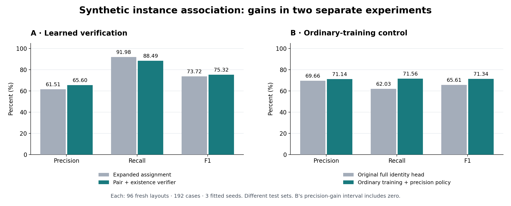

# Room Change: Learning to Verify Object Correspondences

[简体中文](README.zh-CN.md) · [Method and experiment design](docs/METHOD.md) · [Interview notes](docs/INTERVIEW.md) · [All results](results/ALL_RESULTS.md)

**A research portfolio on improving object-instance association across two observations of a static indoor scene.** The broader project targets room-change understanding from two RGB recordings. This repository presents the part with measured gains: recovering candidate matches and learning which matches to retain.

**Result:** on a held-out synthetic test, learned verification improved precision from **61.51% to 65.60%** and F1 from **73.72% to 75.32%** over a frozen expanded-global-assignment baseline. It removed **19.19% of false links** while retaining **96.21% of the baseline's correct links**.

The experiments supply simulator masks and within-recording object grouping. These are **association-module results**, not an end-to-end RGB-video or published state-of-the-art claim.

## What improved

### A. Better precision and F1 than the expanded-matching baseline

The v5 experiment evaluated every method on the same **96 previously untouched layouts / 192 material-paired cases**, with **three fitted seeds**.

| Method | Precision | Recall | F1 |
|---|---:|---:|---:|
| Original full identity head | 71.06% | 64.64% | 67.68% |
| Frozen expanded global assignment | 61.51% | 91.98% | 73.72% |
| Learned pair verifier | 65.87% | 88.02% | 75.33% |
| Pair + existence verifier — prespecified primary | **65.60%** | **88.49%** | **75.32%** |

Relative to expanded assignment, the primary method gained **4.08 percentage points in precision** and **1.60 points in F1**, with a **3.49-point recall cost**. Paired-layout descriptive 95% intervals were **[+2.67, +5.56]** for precision and **[+0.19, +3.05]** for F1.

The simpler pair verifier achieved nearly the same result. The experiment supports learned match verification; it does **not** establish an extra benefit from the existence branch. Precision also remained below the original full identity head in this experiment.

### B. Higher recall and F1 than the original full identity head

The later v7 experiment used a **different** set of **96 fresh layouts / 192 cases**, again evaluated with three fitted seeds.

| Method | Precision | Recall | F1 |
|---|---:|---:|---:|
| Original full identity head | 69.66% | 62.03% | 65.61% |
| Frozen expanded global assignment | 58.71% | 87.97% | 70.42% |
| Previous pair verifier, old cutoff | 63.91% | 81.56% | 71.64% |
| Ordinary training + precision policy — control | **71.14%** | **71.56%** | **71.34%** |

The ordinary-training control gained **9.53 recall points** and **5.74 F1 points** over the original full head. Their descriptive intervals were **[+6.46, +12.60]** and **[+3.09, +8.35]**. Its **+1.48-point precision** estimate had an interval of **[-1.56, +4.64]**, so a reliable precision improvement is not established.

This useful result came from a **predeclared control**, highlighted after evaluation. The prespecified hard-training primary failed and fell back to the original model. The ordinary control also did not beat the previous verifier's F1, and its small F1 advantage over expanded assignment remains uncertain. [Complete tables and interpretation](docs/RESULTS.md).

## What was built

- **Controlled synthetic evaluation:** new layout seeds, 3/5/7-object settings, unchanged/moved/mixed/replaced scenes, paired material regimes, and candidate-drop augmentation.
- **Expanded candidate matching:** all-pair scoring and optional one-to-one global assignment, including unmatched choices and ambiguity rejection.
- **Learned verification:** a small network combines appearance, original-score context and local correspondence summaries to reject unsupported accepted links.
- **Reproducible experimentation:** separate training, validation, calibration and confirmation data; frozen checkpoints and rules; per-seed predictions, hash checks, replay and paired-layout uncertainty.

The published components used by the system—DINOv3, SIFT, standard neural classifiers and assignment optimization—are foundations, not claimed inventions. The contribution shown here is a measured engineering improvement and a controlled evaluation of its tradeoffs.

## Which baselines?

| Comparator | Meaning in this project |
|---|---|
| Original full identity head | Our frozen 29-feature learned association model with an unmatched option. “Full” refers to this head, not the entire room-change system. |
| Expanded global assignment | Our stronger high-recall internal comparator, using the same original scores and an expanded optional one-to-one decoder, without new verifier training. |
| Previous learned verifier | A stronger learned internal control, carried forward with frozen weights and cutoff. |
| Published SceneDiff | An external target for future full-system evaluation. **No superiority over its published method has been established.** |

The expanded comparator is “strong” relative to this project's internal alternatives on the measured test; it is not an externally certified SOTA baseline.

## Read or check this repository

This is a **documentation and evidence release for interviews**, with bilingual explanations, source result snapshots and an arithmetic checker. Model checkpoints, full inference code and raw/cached experiment inputs are in the separately archived experiment packages.

Run the included check with Python 3.11 or later; no packages, token or GPU are needed:

    python scripts/verify_metrics.py

This recomputes P/R/F1 from all 42 method/seed count records, checks the headline arithmetic and included evidence hashes. It does **not** rerun the original models or regenerate bootstrap intervals.

| File | Purpose |
|---|---|
| [README.zh-CN.md](README.zh-CN.md) | Chinese project overview |
| [docs/METHOD.md](docs/METHOD.md) / [中文](docs/METHOD.zh-CN.md) | Algorithm, formulas, baseline definitions and split design |
| [docs/RESULTS.md](docs/RESULTS.md) / [中文](docs/RESULTS.zh-CN.md) | Gains, uncertainty, tradeoffs and verified milestones |
| [docs/INTERVIEW.md](docs/INTERVIEW.md) / [中文](docs/INTERVIEW.zh-CN.md) | Short pitch, CV bullets and technical questions |
| [results/verified_results.json](results/verified_results.json) | Full-precision metrics and headline contrasts |
| [results/ALL_RESULTS.md](results/ALL_RESULTS.md) / [中文](results/ALL_RESULTS.zh-CN.md) | Every method from both highlighted tests |
| [evidence/](evidence/) | Archived summaries, protocols, reports and verification records |
| [docs/REPRODUCIBILITY.md](docs/REPRODUCIBILITY.md) / [中文](docs/REPRODUCIBILITY.zh-CN.md) | Archive access, checksums, replay commands and GitHub setup |

## Scope

The evidence covers new synthetic layouts and materials drawn from five shared procedural object families. It does not establish unseen-category or real-phone-video generalization, arbitrary overlap/viewpoint performance, metric 3D motion accuracy, natural-language quality, or completion of the full 360-by-100 benchmark.

An unmatched observation is not proof of physical removal; an identity link is not proof of movement. Shared 3D alignment, visibility/free-space reasoning and semantic output require separate evaluation in the complete system.

**Evidence reviewed: 11 November 2026.** The measured results above are from the completed v5 and v7 experiments; no new model was trained for this portfolio.
