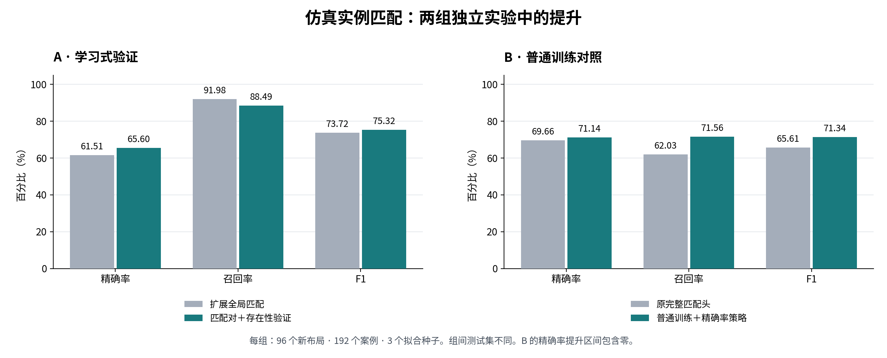

# Room Change：学习验证跨录像物体对应

[English](README.md) · [算法与实验设计](docs/METHOD.zh-CN.md) · [面试讲解](docs/INTERVIEW.zh-CN.md) · [完整结果](results/ALL_RESULTS.zh-CN.md)

**一个研究静态室内场景跨时刻物体身份匹配的项目。** 完整目标是从两段 RGB 录像理解房间发生了什么变化；这里展示其中已有量化提升的部分：扩大匹配候选覆盖，再学习保留哪些对应关系。

**核心结果：**在独立仿真测试中，学习式验证相对冻结的扩展全局匹配基线，将精确率从 **61.51% 提高到 65.60%**，F1 从 **73.72% 提高到 75.32%**；减少 **19.19% 的错误匹配**，保留基线 **96.21% 的正确匹配**。

实验使用仿真器提供的物体掩码和单段录像内的物体分组。这是**身份匹配模块的结果**，不代表端到端 RGB 视频性能或已超过发表方法的最优水平。

## 已验证的提升

### A．相对扩展匹配基线，提高精确率和 F1

v5 将所有方法放在相同的 **96 个此前未使用的布局、192 个配对材质案例**上评估，使用 **3 个拟合种子**。

| 方法 | 精确率 | 召回率 | F1 |
|---|---:|---:|---:|
| 原完整身份匹配头 | 71.06% | 64.64% | 67.68% |
| 冻结的扩展全局匹配 | 61.51% | 91.98% | 73.72% |
| 学习式匹配对验证器 | 65.87% | 88.02% | 75.33% |
| 匹配对＋存在性验证器——预先指定的主方法 | **65.60%** | **88.49%** | **75.32%** |

主方法相对扩展匹配的精确率提高 **4.08 个百分点**、F1 提高 **1.60 个百分点**，代价是召回率下降 **3.49 个百分点**。按布局配对重采样得到的描述性 95% 区间分别为 **[+2.67, +5.56]** 和 **[+0.19, +3.05]**。

更简单的匹配对验证器得到几乎相同的结果。因此，有依据的结论是“学习式验证有效”，不能把收益归功于额外的存在性分支。另外，这一组实验的精确率仍低于原完整匹配头。

### B．相对原完整匹配头，提高召回率和 F1

后续 v7 使用**另一组**新的 **96 个布局、192 个案例**，同样评估三个拟合种子。

| 方法 | 精确率 | 召回率 | F1 |
|---|---:|---:|---:|
| 原完整身份匹配头 | 69.66% | 62.03% | 65.61% |
| 冻结的扩展全局匹配 | 58.71% | 87.97% | 70.42% |
| 前一版匹配对验证器＋旧阈值 | 63.91% | 81.56% | 71.64% |
| 普通训练＋精确率策略——对照方法 | **71.14%** | **71.56%** | **71.34%** |

普通训练对照相对原完整匹配头，召回率提高 **9.53 个百分点**、F1 提高 **5.74 个百分点**，描述性区间分别为 **[+6.46, +12.60]**、**[+3.09, +8.35]**。精确率点估计提高 **1.48 个百分点**，但区间 **[-1.56, +4.64]** 包含零，尚不能断言精确率稳定提高。

这项有用结果来自**预先设置的对照组**，是在分析结果时重点展示的。原先指定的困难样本训练主方法失败，最终回退到原模型。普通训练对照的 F1 也没有超过旧验证器；相对扩展匹配的较小 F1 优势仍不确定。[完整结果与解释](docs/RESULTS.zh-CN.md)。

## 已完成的工程成果

- **可控仿真评测：**独立布局种子，3/5/7 个物体，未变化、移动、混合变化、全部替换四种模式，配对材质方案，以及候选缺失增强。
- **扩展候选匹配：**对所有候选组合评分，进行允许不匹配的一对一全局分配，并对歧义对应保留拒绝能力。
- **学习式验证：**用小型网络结合外观、原始分数上下文和局部对应摘要，过滤证据不足的已接受匹配。
- **可复现实验流程：**区分训练、验证、校准和最终测试；冻结权重与策略；保存逐种子预测、哈希、重放检查和按布局估计的不确定性。

系统使用 DINOv3、SIFT、标准神经分类器和分配优化等现有技术。这些组件本身不是我们的发明；这里可展示的贡献是经过测量的工程改进，以及能够解释得失的对照实验。

## 到底超过了什么基线？

| 对照 | 在本项目中的含义 |
|---|---|
| 原完整身份匹配头 | 我们冻结的 29 维特征学习式匹配模型，带“不匹配”选项。“完整”指这个匹配头，而不是整套房间变化系统。 |
| 扩展全局匹配 | 使用相同原始分数、扩大候选并进行可选一对一分配的高召回内部对照，没有新增验证器训练。 |
| 前一版学习式验证器 | 保留旧权重和阈值的较强学习式内部对照。 |
| 已发表的 SceneDiff | 后续完整系统评测的外部目标；**尚未建立超过其发表方法的结论。** |

扩展匹配的“强”是相对于本项目其他内部对照在该测试上的表现，不等于公认的外部 SOTA 强基线。

## 阅读与检查

本仓库是用于面试的**文档与证据展示包**，包含中英说明、原始统计快照和数值检查脚本。模型权重、完整推理代码和原始／缓存实验输入保存在另行归档的实验包中。

使用 Python 3.11 或更高版本运行，无需额外依赖、令牌或 GPU：

    python scripts/verify_metrics.py

脚本会从全部 42 组“方法×种子”的计数重新计算 P/R/F1，核对核心提升与证据文件哈希。它**不会**重新执行模型推理或重算 bootstrap 区间。

| 文件 | 内容 |
|---|---|
| [README.md](README.md) | 英文项目主页 |
| [docs/METHOD.zh-CN.md](docs/METHOD.zh-CN.md) / [English](docs/METHOD.md) | 算法、公式、基线与数据划分 |
| [docs/RESULTS.zh-CN.md](docs/RESULTS.zh-CN.md) / [English](docs/RESULTS.md) | 提升、不确定性、代价与完成事项 |
| [docs/INTERVIEW.zh-CN.md](docs/INTERVIEW.zh-CN.md) / [English](docs/INTERVIEW.md) | 简述、简历表述与技术问答 |
| [results/verified_results.json](results/verified_results.json) | 未舍入指标和核心比较 |
| [results/ALL_RESULTS.zh-CN.md](results/ALL_RESULTS.zh-CN.md) / [English](results/ALL_RESULTS.md) | 两组实验全部方法 |
| [evidence/](evidence/) | 原始统计、实验协议、报告和复验记录 |
| [docs/REPRODUCIBILITY.zh-CN.md](docs/REPRODUCIBILITY.zh-CN.md) / [English](docs/REPRODUCIBILITY.md) | 归档访问、校验值、重放命令与 GitHub 使用方式 |

## 结论范围

证据覆盖来自五类共享程序化资产的新仿真布局与材质，尚未验证新类别或真实手机录像泛化、任意视角与重合度、米制三维运动误差、自然语言质量，也没有完成完整的 360×100 网格评测。

没有建立匹配不等于物体被移除；建立身份匹配也不等于确认移动。完整系统中的共享三维配准、遮挡／自由空间推理与语义输出仍需要单独评测。

**证据整理日期：2026 年 11 月 11 日。** 上述成绩来自已完成的 v5 和 v7 实验，本次材料整理没有新增模型训练。
